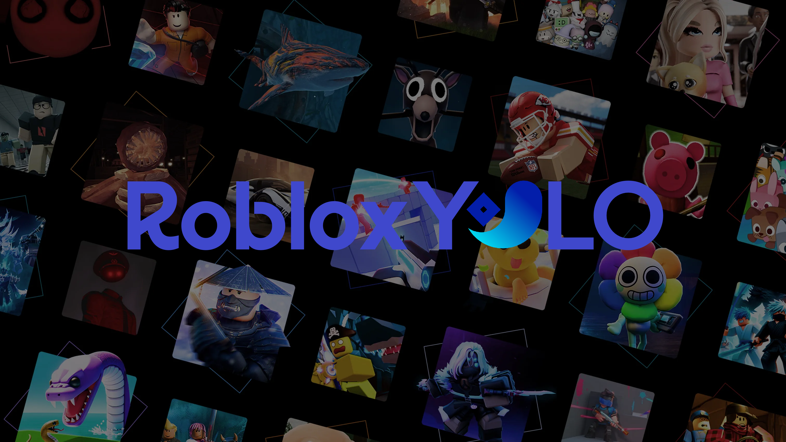
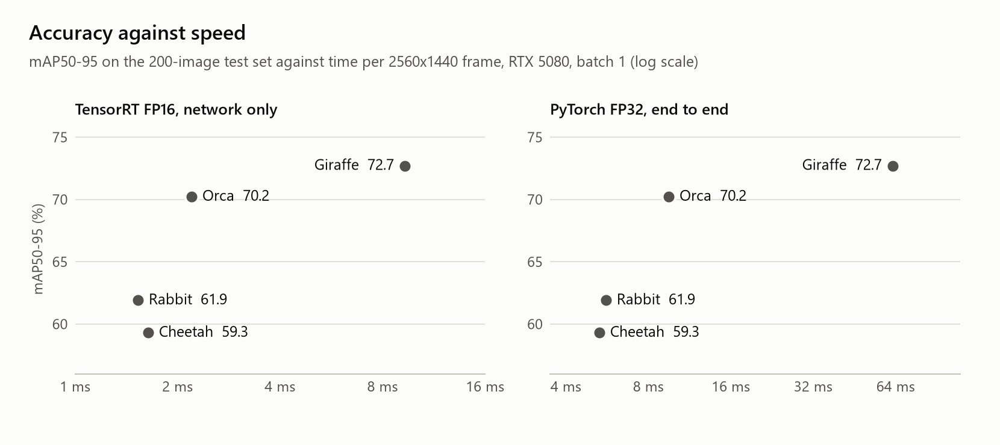
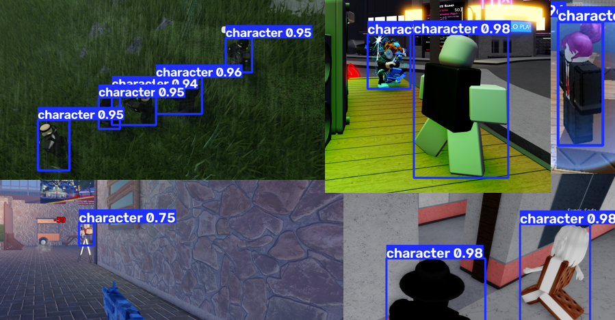
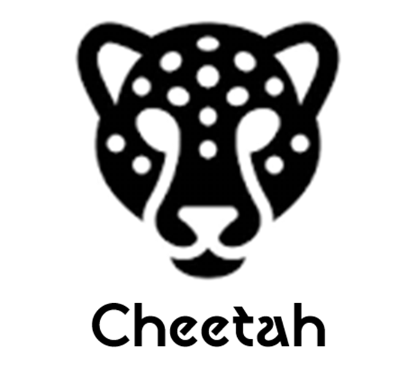
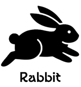
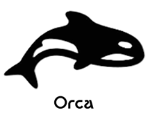
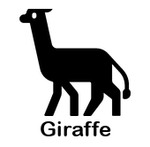
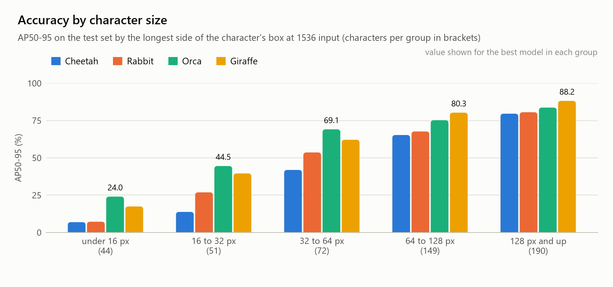
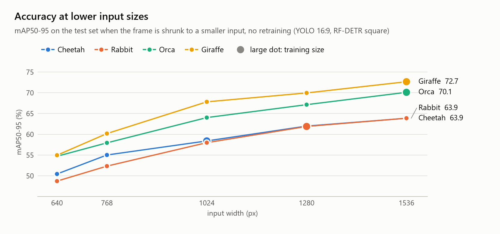

<div align="center">
  <p>
    <a href="https://github.com/rolpon-cpp/roblox-yolo-detector">
      </a>
  </p>

<h1 align="center">Roblox YOLO</h1>

<div>
    <a href="https://docs.ultralytics.com/models/yolo26/"></a>
    <a href="https://docs.ultralytics.com/tasks/detect/"></a>
    <a href="#-models"></a>
    <a href="LICENSE"></a>
    <br>
    <a href="https://github.com/roboflow/rf-detr"></a>
    <a href="https://developer.nvidia.com/tensorrt"></a>
    <a href="https://universe.roboflow.com/rolpon/roblox-yolo26-dataset"></a>
    <a href="https://universe.roboflow.com/rolpon/roblox-public-200img-set"></a>
    <a href="https://github.com/rolpon-cpp/roblox-yolo-detector"></a>
</div>
</div>
<br>

Roblox YOLO is a family of four [object detection](https://docs.ultralytics.com/tasks/detect/) models that find [Roblox](https://www.roblox.com/) characters in screenshots and video frames. Three are built on [Ultralytics YOLO26](https://docs.ultralytics.com/models/yolo26/) and one on [RF-DETR](https://github.com/roboflow/rf-detr). Their training data covers gameplay from several hundred Roblox games, and the models are **fast**, **accurate** and **easy to use**. Every model predicts a single class, `character`, which covers player avatars, NPCs, custom rigs and dead characters, and runs in [PyTorch](https://pytorch.org/) or as an [ONNX](https://onnx.ai/) or [NVIDIA TensorRT](https://developer.nvidia.com/tensorrt) export for real-time use.

Find framework details in the [Ultralytics Docs](https://docs.ultralytics.com/) and the [RF-DETR documentation](https://rfdetr.roboflow.com/). The hand-labeled [training dataset](https://universe.roboflow.com/rolpon/roblox-yolo26-dataset) and [test set](https://universe.roboflow.com/rolpon/roblox-public-200img-set) are on [Roboflow Universe](https://universe.roboflow.com/). Report bugs and ask questions through [GitHub Issues](https://github.com/rolpon-cpp/roblox-yolo-detector/issues).

<picture>
  <source media="(prefers-color-scheme: dark)" srcset="assets/performance-dark.png">
  
</picture>

## 📄 Documentation

See below for installation and usage examples. For training, validation, prediction and export in depth, refer to the [Ultralytics Docs](https://docs.ultralytics.com/) and the [RF-DETR documentation](https://rfdetr.roboflow.com/).

<details open>
<summary>Install</summary>

Clone the repository and install the requirements in a [**Python>=3.10**](https://www.python.org/) environment with [**PyTorch**](https://pytorch.org/get-started/locally/). For GPU inference, install a CUDA build of PyTorch first, following the [PyTorch install selector](https://pytorch.org/get-started/locally/).

[](https://pypi.org/project/ultralytics/) [](https://pypi.org/project/rfdetr/) [](https://pypi.org/project/ultralytics/)

```bash
git clone https://github.com/rolpon-cpp/roblox-yolo-detector
cd roblox-yolo-detector
pip install -r requirements.txt
```

Giraffe also needs the [`rfdetr`](https://pypi.org/project/rfdetr/) package:

```bash
pip install rfdetr
```

For other ways to install the frameworks, see the Ultralytics [Quickstart Guide](https://docs.ultralytics.com/quickstart/) and the [RF-DETR repository](https://github.com/roboflow/rf-detr).

</details>

<details open>
<summary>Usage</summary>

### CLI

Run a YOLO model directly from the command line with the `yolo` command:

```bash
yolo predict model=models/rblx-yolo-orca.pt source=screenshot.png conf=0.5
```

Each model file stores its input size, so `imgsz` does not need to be specified. Explore the [CLI Docs](https://docs.ultralytics.com/usage/cli/) for more options.

### Python

The YOLO models load with the Ultralytics [Python API](https://docs.ultralytics.com/usage/python/) and accept the same [configuration arguments](https://docs.ultralytics.com/usage/cfg/) as the CLI:

```python
from ultralytics import YOLO

model = YOLO("models/rblx-yolo-orca.pt")
results = model("screenshot.png", conf=0.5)

for box in results[0].boxes:
    print(box.xyxy[0].tolist(), box.conf.item())

results[0].show()  # display the image with its boxes
```

See [Predict mode](https://docs.ultralytics.com/modes/predict/) for videos, folders and streams, and [Track mode](https://docs.ultralytics.com/modes/track/) to follow characters across video frames.

### Giraffe (RF-DETR)

```python
from PIL import Image
from rfdetr import RFDETR

model = RFDETR.from_checkpoint("models/rblx-rfdetr-giraffe.pth")
detections = model.predict(Image.open("screenshot.png"), threshold=0.5)

for box, conf in zip(detections.xyxy, detections.confidence):
    print(box.tolist(), float(conf))
```

`predict` returns [supervision](https://supervision.roboflow.com/) `Detections`. Pass a path that includes a folder, as above, or an absolute path: a bare file name is looked up in RF-DETR's download cache instead.

### Export

Export the YOLO models to [ONNX](https://docs.ultralytics.com/integrations/onnx/) or [TensorRT](https://docs.ultralytics.com/integrations/tensorrt/) with [Export mode](https://docs.ultralytics.com/modes/export/). Use a fixed 16:9 input that matches the model, so a 16:9 frame fills it without padding:

| Model | Export `imgsz` |
|---|---|
| Cheetah | `[576, 1024]` |
| Rabbit | `[736, 1280]` |
| Orca | `[864, 1536]` |

```python
from ultralytics import YOLO

model = YOLO("models/rblx-yolo-orca.pt")
model.export(format="onnx", imgsz=[864, 1536])
model.export(format="engine", quantize="fp16", dynamic=False, batch=1, imgsz=[864, 1536])
```

TensorRT engines must be built on the GPU that will run them. Install the [TensorRT](https://developer.nvidia.com/tensorrt) Python package that matches the CUDA version of your PyTorch build first, for example `pip install tensorrt-cu12` for CUDA 12. Giraffe exports with RF-DETR's own `model.export()`; see the [RF-DETR documentation](https://rfdetr.roboflow.com/).

### Real-time overlay (TensorRT only)

[`examples/real_time_inference.py`](examples/real_time_inference.py) draws live boxes over the Roblox window. It captures the game window with [windows-capture](https://pypi.org/project/windows-capture/), runs a TensorRT engine with resizing and [non-maximum suppression](https://docs.pytorch.org/vision/stable/generated/torchvision.ops.nms.html) on the GPU, follows characters with [ByteTrack](https://arxiv.org/abs/2110.06864), and draws the boxes on a transparent, click-through [pygame-ce](https://pyga.me/) window.

> [!IMPORTANT]
> The real-time example only works with **TensorRT engines**. It does not load `.pt` or `.pth` files and does not support Giraffe. It needs Windows, an NVIDIA GPU and the TensorRT Python package.

1. Build the engine (the example uses Cheetah by default):

   ```bash
   yolo export model=models/rblx-yolo-cheetah.pt format=engine quantize=fp16 batch=1 imgsz=576,1024
   ```

2. Start Roblox, then run the example from the repository root:

   ```bash
   python examples/real_time_inference.py
   ```

3. Stop it with Ctrl+C in the console. To use Rabbit or Orca, export it with its `imgsz` from the table above and change `ENGINE` at the top of the script.

</details>

## ✨ Models



Roblox YOLO comes in four models, from the fastest (Cheetah) to the most accurate (Giraffe). Orca is recommended where an NVIDIA GPU is available. Rabbit and Cheetah are intended for lower-end hardware. Giraffe gives the highest accuracy for about four to seven times Orca's time per frame.

<table align="center">
<tr>
<td align="center" width="25%"><br/><b>Cheetah</b></td>
<td align="center" width="25%"><br/><b>Rabbit</b></td>
<td align="center" width="25%"><br/><b>Orca</b></td>
<td align="center" width="25%"><br/><b>Giraffe</b></td>
</tr>
</table>

<details open><summary>Detection (Roblox test set)</summary>

See the [Detection Docs](https://docs.ultralytics.com/tasks/detect/) for usage examples. All four models detect one class, `character`.

| Model | Architecture | size<br><sup>(pixels)</sup> | mAP<sup>test<br>50-95</sup> | mAP<sup>test<br>50</sup> | Speed<br><sup>RTX 5080 PyTorch FP32<br>(ms)</sup> | Speed<br><sup>RTX 5080 TensorRT FP16<br>(ms)</sup> | params<br><sup>(M)</sup> | FLOPs<br><sup>(B)</sup> |
|---|---|---|---|---|---|---|---|---|
| [Cheetah](models/rblx-yolo-cheetah.pt) | [YOLO26n](https://docs.ultralytics.com/models/yolo26/) | 1024 | 59.3 | 78.4 | 5.3 | 1.6 | 2.5 | 8.3 |
| [Rabbit](models/rblx-yolo-rabbit.pt) | [YOLO26n](https://docs.ultralytics.com/models/yolo26/) | 1280 | 61.9 | 79.9 | 5.6 | 1.5 | 2.5 | 13.6 |
| [Orca](models/rblx-yolo-orca.pt) | [YOLO26s](https://docs.ultralytics.com/models/yolo26/) | 1536 | 70.2 | 86.9 | 9.5 | 2.2 | 9.9 | 74.5 |
| [Giraffe](models/rblx-rfdetr-giraffe.pth) | [RF-DETR Small](https://github.com/roboflow/rf-detr) | 1536 | 72.7 | 90.0 | 62.4 | 9.3 | 34.9 | 431.4 |

- **mAP<sup>test</sup>** values are single-model, single-scale results on a held-out test set of 200 screenshots at 2560x1440 with 506 labeled characters and 32 images without characters. No test images, and no training images of the same scenes, were used in training. See [YOLO Performance Metrics](https://docs.ultralytics.com/guides/yolo-performance-metrics/) for what the metrics mean. <br>YOLO scores come from [`yolo val`](https://docs.ultralytics.com/modes/val/) at each model's input size, for example `yolo val model=models/rblx-yolo-orca.pt data=test.yaml`. `yolo val` cannot load RF-DETR, so Giraffe's predictions were scored with the same matching code; on Orca this method reads within 0.1 of `yolo val`. The [public test set](https://universe.roboflow.com/rolpon/roblox-public-200img-set) holds 199 of the 200 images, so a rerun differs slightly.
- **Speed** is measured on an NVIDIA RTX 5080 at batch 1 with 2560x1440 frames. PyTorch FP32 times are end to end (resizing, network and decoding). TensorRT FP16 times cover the network only, and FP16 engines score within 0.2 mAP of the PyTorch models. The two nano engines are limited by launch overhead on this GPU, so their times are equal within measurement noise.
- **params** and **FLOPs** are counted for each released file at its input size: 16:9 for YOLO (for example 1536x864) and 1536x1536 for Giraffe, which resizes every frame to a square. Giraffe's weights are stored in half precision to stay under GitHub's file size limit; on the test set it scores the same as the full-precision model.

</details>

<details><summary>Accuracy by character size</summary>

<picture>
  <source media="(prefers-color-scheme: dark)" srcset="assets/size-ap-dark.png">
  
</picture>

Size is the longest side of a character's bounding box at 1536 input. Values are AP50-95 (%), scored from `model.predict` output.

| Size | under 16 px | 16 to 32 px | 32 to 64 px | 64 to 128 px | 128 px and up |
|---|---|---|---|---|---|
| Characters in the test set | 44 | 51 | 72 | 149 | 190 |
| Cheetah | 6.9 | 13.8 | 41.9 | 65.3 | 79.6 |
| Rabbit | 7.2 | 26.9 | 53.6 | 67.7 | 80.6 |
| Orca | 24.0 | 44.5 | 69.1 | 75.2 | 83.7 |
| Giraffe | 17.4 | 39.6 | 62.1 | 80.3 | 88.2 |

Orca finds small and mid-size characters best. Giraffe leads for characters of 64 px and larger, which make up most of the test set.

</details>

<details><summary>Accuracy at lower input sizes</summary>

<picture>
  <source media="(prefers-color-scheme: dark)" srcset="assets/input-size-dark.png">
  
</picture>

mAP50-95 (%) when the frame is shrunk to a smaller input, without retraining. YOLO inputs are 16:9 (for example 1024x576); Giraffe's are square.

| Input width | 1536 | 1280 | 1024 | 768 | 640 |
|---|---|---|---|---|---|
| Cheetah | 63.9 | 62.0 | 58.4 | 55.0 | 50.4 |
| Rabbit | 63.9 | 61.9 | 58.0 | 52.3 | 48.7 |
| Orca | 70.1 | 67.1 | 64.0 | 57.9 | 54.7 |
| Giraffe | 72.7 | 70.0 | 67.8 | 60.2 | 55.0 |

Measured with `model.predict`, which reads up to about 1 point below `yolo val` (Cheetah at 1024: 58.4 here, 59.3 with `yolo val`). Cheetah and Rabbit score about the same at 1024 and above, and Cheetah holds up better below 1024. Below 1024 most of the loss comes from characters under 64 px.

</details>

## 📚 Training

Training data consists of approximately 5,000 hand-labeled images and a larger set of automatically labeled gameplay frames. Automatic labels were limited to high-confidence detections. Orca was additionally trained on synthetic images of difficult cases, and Giraffe was trained on the hand-labeled images only. Released weights are averages of checkpoints from a single training run, as in [stochastic weight averaging](https://arxiv.org/abs/1803.05407).

The hand-labeled dataset and the test set are available on Roboflow:

- Dataset: https://universe.roboflow.com/rolpon/roblox-yolo26-dataset
- Test set: https://universe.roboflow.com/rolpon/roblox-public-200img-set

Some images were removed from the published datasets because they contained private information, so the final sizes are slightly lower than expected: the dataset has about 5,600 images (about 6,000 before), and the test set has 199 images (200 before). The results in [Models](#-models) were measured on the original 200-image test set.

Example fine-tuning command (see [Train mode](https://docs.ultralytics.com/modes/train/)):

```python
from ultralytics import YOLO

model = YOLO("models/rblx-yolo-orca.pt")
model.train(data="data.yaml", imgsz=1536, epochs=25, batch=5, optimizer="MuSGD", lr0=0.002, lrf=0.1)
```

Set `optimizer` explicitly. The `auto` setting selects different optimizers depending on dataset size. Giraffe can be fine-tuned with RF-DETR's training API; see the [RF-DETR documentation](https://rfdetr.roboflow.com/).

## 📝 Labeling Specification

- Each character receives one bounding box enclosing all visible pixels. Name tags are excluded.
- Boxes include attached items such as wings, weapons and accessories. Particle effects are excluded.
- Overlapping characters receive separate boxes where possible.
- Player characters, NPCs, custom rigs and dead characters are labeled as characters.
- Menu renders, leaderboard statues, paintings, drawings and real people are not labeled.
- Images that are not Roblox gameplay are treated as background.

## 🚧 Limitations

- Characters smaller than 16 px at the model input size are frequently missed.
- Recall is reduced in dark scenes and for overlapping or partially visible characters.
- Leaderboard statues and character figures in game menus account for most false positives.
- Training data consists of desktop gameplay. Accuracy on mobile layouts has not been measured.
- Giraffe needs about four to seven times Orca's time per frame. For real-time use, run it as a TensorRT FP16 engine.

## 🤝 Contribute

Bug reports, feature requests and example images are welcome through [GitHub Issues](https://github.com/rolpon-cpp/roblox-yolo-detector/issues). Issues and pull requests related to aim assistance will not be accepted (see [Disclaimers](#-disclaimers)).

## 📜 License

This project is licensed under [AGPL-3.0](LICENSE), consistent with the [Ultralytics YOLO](https://github.com/ultralytics/ultralytics) framework. Giraffe is fine-tuned from [RF-DETR](https://github.com/roboflow/rf-detr), which is released under [Apache-2.0](https://www.apache.org/licenses/LICENSE-2.0). The models are provided without warranty.

## 📢 Disclaimers

This project is not affiliated with or endorsed by Roblox Corporation. Roblox is a trademark of Roblox Corporation. Dataset images are screenshots of Roblox gameplay and remain the property of their respective owners.

The models may be used for aim assistance. This use is not prohibited but is discouraged, and related issues or pull requests will not be accepted. Automated input programs violate the [Roblox Terms of Use](https://en.help.roblox.com/hc/en-us/articles/115004647846-Roblox-Terms-of-Use) and may result in account termination.

[Claude](https://www.anthropic.com/claude) (Anthropic) assisted with model development and documentation. All manual labels were created or reviewed by the author.

## 📞 Contact

For bug reports and feature requests, open a [GitHub Issue](https://github.com/rolpon-cpp/roblox-yolo-detector/issues). For questions about the frameworks, see the [Ultralytics Docs](https://docs.ultralytics.com/), the [Ultralytics Community Forums](https://community.ultralytics.com/) and the [RF-DETR repository](https://github.com/roboflow/rf-detr).
