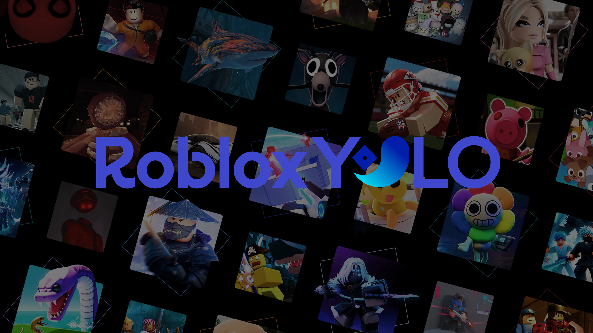
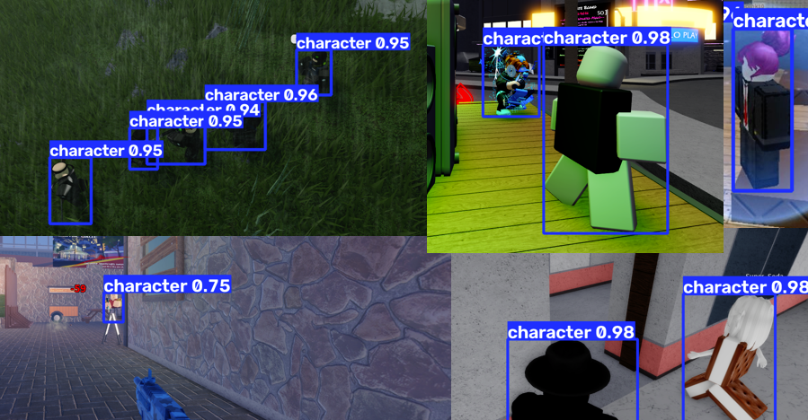
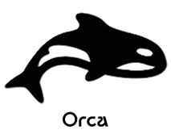
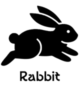
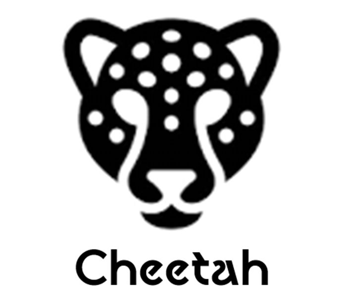

<h1 align="center">Roblox YOLO</h1>

<p align="center">
  <b>High-accuracy Roblox character detection, built on YOLO26.</b><br/>
  Three models, one class, from real-time lightweight to maximum accuracy.
</p>

<p align="center">
  
  
  
  
</p>

---

## Table of Contents

- [Overview](#overview)
- [Quick Start](#quick-start)
- [Available Models](#available-models)
- [Training](#training)
- [Documentation](#documentation)
- [Disclaimers & Disclosures](#disclaimers--disclosures)

---

## Overview

Roblox-YOLO is a family of high-accuracy Roblox character detection models developed by Rolpon. Built on YOLO26, they are general purpose detectors suited to autonomous bots and utility tools, and have been trained on a variety of Roblox games to provide detection that holds up across the platform.

**Highlights**

- **Three models** covering the full speed and accuracy range.
- **Up to 85.7% mAP50** and **68.8% mAP50-95** on a 200 image test set (Orca).
- **Single class**, `character`, which detects both alive and dead Roblox characters.
- **Real-time ready** with ONNX and TensorRT export support.
- **Public dataset and test set** hosted on Roboflow.



---

## Quick Start

Install dependencies:

```bash
pip install -r requirements.txt
```

Run inference on an image:

```python
from ultralytics import YOLO

# Load a rblx YOLO model
model = YOLO("models/rblx-yolo-cheetah.pt")

# Perform object detection on an image
results = model("sample_images/image1.png")  # Predict on an image
results[0].show()  # Display results
```

### Real-Time Inference

See [`examples/real_time_inference.py`](examples/real_time_inference.py) for a complete real-time example.
Export to ONNX or TensorRT if you plan to use these models in real time.

### Export a Model

```python
from ultralytics import YOLO

# Load a rblx YOLO model
model = YOLO("models/rblx-yolo-cheetah.pt")

# Export the model to ONNX format for deployment
path = model.export(format="onnx")  # Returns the path to the exported model

# Export the model to TensorRT format for deployment on CUDA
path = model.export(format="engine", dynamic=False, quantize=16)
```

---

## Available Models

> mAP numbers were determined on the 200 image test set.

| Model | Architecture | Image Size | mAP50 | mAP50-95 | Best For |
|---|---|---|---|---|---|
| **Orca** | YOLO26s | 1536 | **85.7%** | **68.8%** | Maximum accuracy |
| **Rabbit** | YOLO26n | 1280 | 79.9% | 61.9% | Balance of speed and accuracy |
| **Cheetah** | YOLO26n | 1024 | 78.4% | 59.3% | Real-time inference, fastest |

<table>
<tr>
<td align="center" width="33%">
<br/>
<b>Orca</b>
</td>
<td align="center" width="33%">
<br/>
<b>Rabbit</b>
</td>
<td align="center" width="33%">
<br/>
<b>Cheetah</b>
</td>
</tr>
</table>

### Training Data

All models were originally trained on 5,000 to 6,000 human-labeled images, with augmentation settings turned up.

### Orca

The most powerful and accurate model in the family. YOLO26s at imgsz 1536, reaching **85.7% mAP50** and **68.8% mAP50-95**.

- Trained on **6,000 images** combined with **10,000 distilled images**.

### Rabbit

YOLO26n at imgsz 1280. A balance of speed and accuracy, reaching 79.9% mAP50 and 61.9% mAP50-95.

### Cheetah

YOLO26n at imgsz 1024. The fastest model, reaching 78.4% mAP50 and 59.3% mAP50-95. Also trained with distillation. Recommended for real-time inference.

---

## Training

The dataset is public on Roboflow. You will need a capable GPU machine or Google Colab to train a model.

| Resource | Link |
|---|---|
| Dataset | https://universe.roboflow.com/rolpon/roblox-yolo26-detector |
| Test Set | https://universe.roboflow.com/rolpon/publictestset |

```python
from ultralytics import YOLO

# Load a YOLO model from COCO
model = YOLO("yolo26s.pt")

# Train a YOLO model
model.train(data="data.yaml", epochs=300, patience=50, name="roblox-yolo-custom")
```

**Training trends**

- `yolo26s.pt` works best.
- 250 to 300 epochs works best.
- imgsz 1536 seems to be good.
- batch 10, workers 7 is an ideal setup.

**Dataset creation**

1. Copy in hand-labeled data.
2. Split train/val 80%/20%.

---

## Documentation

### Labeling Spec

- Include all visible pixels of a character (1 box per character), with the exceptions below.
- If multiple characters intersect, attempt to give each character a unique box.
- Use the tightest possible bounding boxes, with no name tags included.
- If individual bounding boxes are truly not possible, use a single-blob box.
- Boxes include all extents of a character, including wings, large arms, and accessories. Particles are not counted.
- Highlights on characters are counted.
- All non-Roblox images are background (real-life photos, browsers, desktop environments, the Roblox website, etc.).
- Fake Roblox characters, UI character renders, and paintings do not count as characters. Only NPCs and player characters count.
- Dead characters are accounted for, either in their own class or merged with the character class.

### Known Pain Points

| Pain Point | Potential Solution |
|---|---|
| UI/overlays on top of characters | Synthetic data or manual collection |
| Overlapping characters | Studio synthetic data or manual collection |
| Small trees and blocky objects causing false positives | Manual collection |
| UI elements confused for characters | Synthetic data |
| Close-up shots of characters | Manual collection |
| Far shots of characters | Studio synthetic data and Isle manual collection |
| Effects and particles on characters | Synthetic data or Studio synthetic data |
| MM2 paintings | Collect from MM2, Doors, and online pictures manually |

---

## Disclaimers & Disclosures

Claude AI was used to assist in the planning, use, and production of these AI models.

These models can be used for aimbot purposes, and I will not ban those uses. I will, however, severely discourage them. I will not accept aimbot related changes. These models were developed for hobbyist and utility purposes, not to cheat. Aimbotting on Roblox via YOLO and macro programs violates Roblox ToS and could result in a ban.

Watch the labeling process: https://youtu.be/3P5Tr6R4R_I
